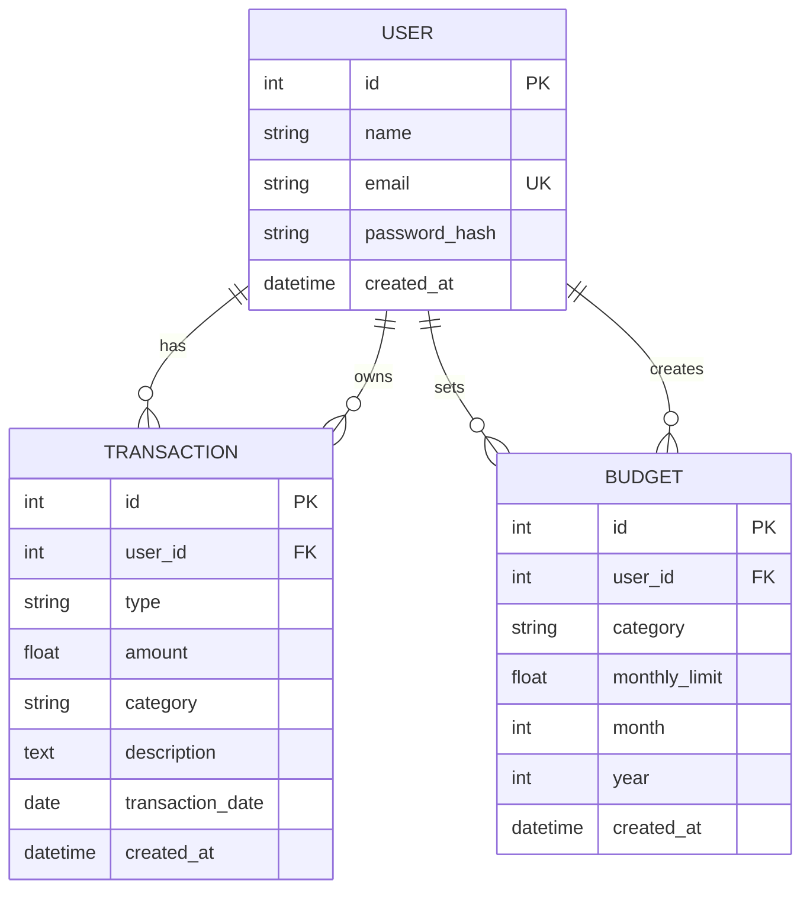
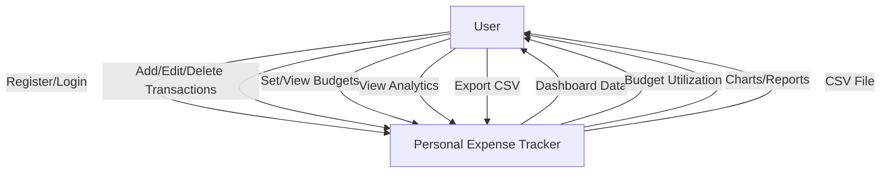
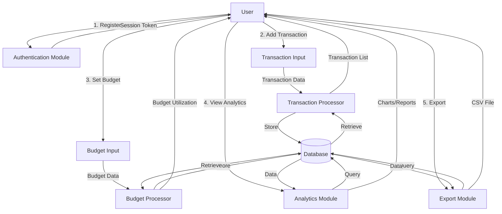

# Personal Expense Tracker - Project Documentation

## Abstract

The Personal Expense Tracker is a comprehensive full-stack web application designed to help individuals manage their personal finances efficiently. This application provides users with the ability to track income and expenses, set and monitor budgets, analyze spending patterns through visual charts, and export financial reports. Built using Python Flask for the backend and modern web technologies for the frontend, the application ensures data security through proper authentication and user isolation. The system addresses the common problem of disorganized financial tracking by providing a centralized, user-friendly platform for personal finance management.

## Existing System

### Manual Expense Tracking
Most individuals currently manage their finances through:
- **Spreadsheets**: Excel or Google Sheets requiring manual entry and calculation
- **Notebooks**: Physical notebooks prone to damage and loss
- **Memory**: Relying on mental tracking which is unreliable
- **Banking Apps**: Limited to viewing transactions without categorization or budgeting
- **Multiple Apps**: Using different apps for different financial aspects

### Limitations of Existing Methods
- **Time-consuming**: Manual entry and calculations take significant time
- **Error-prone**: Human errors in calculations and data entry
- **Lack of Analytics**: Limited or no visual insights into spending patterns
- **No Budgeting**: Difficulty in setting and tracking budgets
- **Inaccessible**: Data not available across devices
- **No Categorization**: Transactions not organized by categories
- **Security Risks**: Physical notebooks can be lost or damaged
- **No Historical Data**: Difficulty in tracking long-term financial trends

## Proposed System

### System Overview
The Personal Expense Tracker is a web-based application that provides:
- **Centralized Data Management**: All financial data in one secure location
- **User Authentication**: Secure login system with password hashing
- **Transaction Management**: Easy CRUD operations for income and expenses
- **Budget Tracking**: Set monthly budgets and monitor utilization
- **Visual Analytics**: Charts and graphs for spending insights
- **Data Export**: CSV export for external analysis
- **Responsive Design**: Accessible on desktop, tablet, and mobile devices
- **User Isolation**: Each user's data is completely isolated from others

### Key Features
1. **Authentication System**
   - User registration with email validation
   - Secure login with password hashing
   - Session management
   - Protected routes

2. **Dashboard**
   - Financial summary cards
   - Monthly income vs expense chart
   - Category-wise expense breakdown
   - Recent transactions list

3. **Transaction Management**
   - Add, edit, delete transactions
   - Search and filter functionality
   - Date range filtering
   - Category-based filtering

4. **Budget Management**
   - Create monthly budgets
   - Track budget utilization
   - Progress indicators with warnings
   - Month/year navigation

5. **Analytics**
   - Monthly trends
   - Category analysis
   - Spending patterns
   - Export capabilities

## Functional Requirements

### FR-1: User Authentication
- **FR-1.1**: System shall allow users to register with name, email, and password
- **FR-1.2**: System shall validate email format and uniqueness
- **FR-1.3**: System shall hash passwords before storage
- **FR-1.4**: System shall allow users to login with email and password
- **FR-1.5**: System shall provide session management
- **FR-1.6**: System shall allow users to logout
- **FR-1.7**: System shall redirect unauthenticated users to login page

### FR-2: Transaction Management
- **FR-2.1**: System shall allow users to add income transactions
- **FR-2.2**: System shall allow users to add expense transactions
- **FR-2.3**: System shall require transaction type, amount, category, and date
- **FR-2.4**: System shall validate amount is greater than zero
- **FR-2.5**: System shall allow users to edit transactions
- **FR-2.6**: System shall allow users to delete transactions
- **FR-2.7**: System shall display transaction history
- **FR-2.8**: System shall allow filtering by transaction type
- **FR-2.9**: System shall allow filtering by category
- **FR-2.10**: System shall allow filtering by date range
- **FR-2.11**: System shall allow searching by description
- **FR-2.12**: System shall export transactions as CSV

### FR-3: Budget Management
- **FR-3.1**: System shall allow users to create budgets for categories
- **FR-3.2**: System shall allow users to set monthly spending limits
- **FR-3.3**: System shall prevent duplicate budgets for same category/month/year
- **FR-3.4**: System shall calculate budget utilization
- **FR-3.5**: System shall display progress bars for budget utilization
- **FR-3.6**: System shall show warning at 75% utilization
- **FR-3.7**: System shall show high-spending warning at 90% utilization
- **FR-3.8**: System shall show budget exceeded warning at 100% utilization
- **FR-3.9**: System shall allow users to edit budgets
- **FR-3.10**: System shall allow users to delete budgets

### FR-4: Dashboard
- **FR-4.1**: System shall display total income
- **FR-4.2**: System shall display total expenses
- **FR-4.3**: System shall display current balance
- **FR-4.4**: System shall display monthly savings
- **FR-4.5**: System shall display monthly income vs expense chart
- **FR-4.6**: System shall display category-wise expense chart
- **FR-4.7**: System shall display recent transactions

### FR-5: Analytics
- **FR-5.1**: System shall provide monthly income report
- **FR-5.2**: System shall provide monthly expense report
- **FR-5.3**: System shall provide category-wise expense breakdown
- **FR-5.4**: System shall provide income vs expense comparison
- **FR-5.5**: System shall provide monthly spending trends
- **FR-5.6**: System shall identify highest spending category
- **FR-5.7**: System shall calculate average monthly expenses

### FR-6: Profile Management
- **FR-6.1**: System shall allow users to update name
- **FR-6.2**: System shall allow users to update email
- **FR-6.3**: System shall display account creation date

## Non-Functional Requirements

### NFR-1: Performance
- **NFR-1.1**: System shall load dashboard within 3 seconds
- **NFR-1.2**: System shall handle at least 1000 transactions per user
- **NFR-1.3**: System shall respond to API requests within 500ms

### NFR-2: Security
- **NFR-2.1**: System shall hash all passwords using Werkzeug
- **NFR-2.2**: System shall use HTTPS in production
- **NFR-2.3**: System shall implement CSRF protection
- **NFR-2.4**: System shall isolate user data
- **NFR-2.5**: System shall validate all inputs on backend
- **NFR-2.6**: System shall use secure session configuration

### NFR-3: Usability
- **NFR-3.1**: System shall have intuitive navigation
- **NFR-3.2**: System shall provide clear error messages
- **NFR-3.3**: System shall be responsive on mobile devices
- **NFR-3.4**: System shall support modern browsers (Chrome, Firefox, Safari, Edge)

### NFR-4: Reliability
- **NFR-4.1**: System shall have 99% uptime
- **NFR-4.2**: System shall handle database errors gracefully
- **NFR-4.3**: System shall provide error pages for 404 and 500 errors

### NFR-5: Scalability
- **NFR-5.1**: System shall support at least 1000 concurrent users
- **NFR-5.2**: System shall allow database migration to PostgreSQL/MySQL

### NFR-6: Maintainability
- **NFR-6.1**: Code shall follow PEP 8 style guidelines
- **NFR-6.2**: Code shall have meaningful variable names
- **NFR-6.3**: Code shall include comments for complex logic
- **NFR-6.4**: System shall have modular architecture

## System Architecture

### Architecture Pattern
The application follows the **Model-View-Controller (MVC)** pattern with a **Service Layer** for business logic separation.

### Components

#### 1. Presentation Layer (Templates)
- **HTML Templates**: Jinja2 templates for rendering views
- **CSS**: Custom styling with Bootstrap 5
- **JavaScript**: Client-side interactivity

#### 2. Application Layer (Routes/Controllers)
- **Flask Blueprints**: Modular route organization
- **Request Handling**: GET and POST method handling
- **Response Generation**: HTML and JSON responses

#### 3. Service Layer (Business Logic)
- **TransactionService**: Transaction operations
- **BudgetService**: Budget operations
- **AnalyticsService**: Analytics calculations

#### 4. Data Access Layer (Models)
- **SQLAlchemy ORM**: Database abstraction
- **Models**: User, Transaction, Budget

#### 5. Database Layer
- **SQLite**: Default database (development)
- **PostgreSQL/MySQL**: Production options

### Architecture Diagram

```
┌─────────────────────────────────────────────────────────┐
│                     User Browser                         │
│              (HTML/CSS/JavaScript)                       │
└──────────────────────┬──────────────────────────────────┘
                       │ HTTP/HTTPS
                       ▼
┌─────────────────────────────────────────────────────────┐
│                   Flask Application                       │
│  ┌──────────────────────────────────────────────────┐  │
│  │              Routes (Controllers)                 │  │
│  │  ┌──────────┐  ┌──────────┐  ┌──────────┐     │  │
│  │  │   Auth   │  │Dashboard │  │Transaction│     │  │
│  │  └──────────┘  └──────────┘  └──────────┘     │  │
│  └──────────────────────┬───────────────────────────┘  │
│                         │                                 │
│  ┌──────────────────────▼───────────────────────────┐  │
│  │              Service Layer                       │  │
│  │  ┌──────────────────┐  ┌──────────────────┐     │  │
│  │  │ Transaction Svc  │  │  Budget Service  │     │  │
│  │  └──────────────────┘  └──────────────────┘     │  │
│  └──────────────────────┬───────────────────────────┘  │
│                         │                                 │
│  ┌──────────────────────▼───────────────────────────┐  │
│  │              Data Access Layer                    │  │
│  │  ┌──────────┐  ┌──────────┐  ┌──────────┐     │  │
│  │  │   User   │  │Transaction│  │  Budget  │     │  │
│  │  └──────────┘  └──────────┘  └──────────┘     │  │
│  └──────────────────────┬───────────────────────────┘  │
└──────────────────────────┼──────────────────────────────┘
                           │
                           ▼
┌─────────────────────────────────────────────────────────┐
│                  SQLite Database                         │
│  ┌──────────┐  ┌──────────┐  ┌──────────┐           │
│  │  users   │  │transactions││  budgets │           │
│  └──────────┘  └──────────┘  └──────────┘           │
└─────────────────────────────────────────────────────────┘
```

## Database Design

### Entity-Relationship Diagram (Mermaid)



### Table Descriptions

#### Users Table
| Column | Type | Constraints | Description |
|--------|------|-------------|-------------|
| id | Integer | PRIMARY KEY | Unique identifier |
| name | String(100) | NOT NULL | User's full name |
| email | String(120) | UNIQUE, NOT NULL, INDEX | User's email |
| password_hash | String(255) | NOT NULL | Hashed password |
| created_at | DateTime | DEFAULT NOW | Account creation date |

#### Transactions Table
| Column | Type | Constraints | Description |
|--------|------|-------------|-------------|
| id | Integer | PRIMARY KEY | Unique identifier |
| user_id | Integer | FOREIGN KEY, NOT NULL, INDEX | Reference to user |
| type | String(10) | NOT NULL | 'income' or 'expense' |
| amount | Float | NOT NULL | Transaction amount |
| category | String(50) | NOT NULL | Transaction category |
| description | Text | NULLABLE | Transaction description |
| transaction_date | Date | NOT NULL, INDEX | Date of transaction |
| created_at | DateTime | DEFAULT NOW, INDEX | Record creation date |

#### Budgets Table
| Column | Type | Constraints | Description |
|--------|------|-------------|-------------|
| id | Integer | PRIMARY KEY | Unique identifier |
| user_id | Integer | FOREIGN KEY, NOT NULL, INDEX | Reference to user |
| category | String(50) | NOT NULL | Budget category |
| monthly_limit | Float | NOT NULL | Monthly spending limit |
| month | Integer | NOT NULL | Month (1-12) |
| year | Integer | NOT NULL | Year |
| created_at | DateTime | DEFAULT NOW | Record creation date |

**Unique Constraint**: (user_id, category, month, year)

### Relationships
- **User to Transaction**: One-to-Many (A user can have many transactions)
- **User to Budget**: One-to-Many (A user can have many budgets)
- **Transaction to User**: Many-to-One (Many transactions belong to one user)
- **Budget to User**: Many-to-One (Many budgets belong to one user)

## Data Flow Diagram

### Level 0 DFD (Context Diagram)



### Level 1 DFD



## Testing Strategy

### Testing Approach
The application uses **pytest** for automated testing with a **test-driven development (TDD)** approach where possible.

### Test Categories

#### 1. Unit Tests
- **Model Tests**: Test database model methods
- **Service Tests**: Test business logic in isolation
- **Validator Tests**: Test input validation functions

#### 2. Integration Tests
- **Route Tests**: Test route handlers with database
- **Authentication Tests**: Test login/logout flows
- **Transaction Tests**: Test CRUD operations end-to-end

#### 3. Functional Tests
- **User Workflows**: Test complete user journeys
- **Form Submissions**: Test form validation and processing
- **Data Export**: Test CSV export functionality

### Test Coverage

#### Authentication Tests (test_auth.py)
- User registration with valid data
- Registration with duplicate email
- Registration with invalid email
- Registration with password mismatch
- Registration with short password
- Login with valid credentials
- Login with invalid email
- Login with invalid password
- Logout functionality
- Protected route redirection
- Authenticated access to dashboard

#### Transaction Tests (test_transactions.py)
- Add income transaction
- Add expense transaction
- Add transaction with invalid amount
- Add transaction with invalid date
- View transactions list
- Filter by transaction type
- Edit transaction
- Delete transaction
- User data isolation

#### Budget Tests (test_budgets.py)
- Add budget
- Add duplicate budget
- Add budget with invalid amount
- View budgets
- Edit budget
- Delete budget
- Budget utilization calculation

#### Dashboard Tests (test_dashboard.py)
- Dashboard access for authenticated user
- Dashboard financial calculations
- Recent transactions display
- Dashboard empty state
- Dashboard redirect for unauthenticated user
- CSV export functionality

### Test Execution

```bash
# Run all tests
pytest

# Run specific test file
pytest tests/test_auth.py

# Run with verbose output
pytest -v

# Run with coverage
pytest --cov=app --cov-report=html
```

### Test Data Management
- Tests use in-memory SQLite database
- Each test runs in isolation
- Database is created and destroyed for each test
- Test fixtures provide reusable test data

## Conclusion

The Personal Expense Tracker is a comprehensive, well-architected full-stack web application that addresses the common problem of personal finance management. By providing a centralized platform with features for transaction tracking, budget management, and visual analytics, the application helps users gain better control over their finances.

### Key Achievements
- **Complete Authentication System**: Secure user registration and login
- **Transaction Management**: Full CRUD operations with filtering
- **Budget Tracking**: Real-time utilization with warnings
- **Visual Analytics**: Charts and graphs for insights
- **Responsive Design**: Accessible on all devices
- **Data Security**: User isolation and password hashing
- **Comprehensive Testing**: Automated test suite
- **Modular Architecture**: Maintainable and scalable code

### Technical Excellence
- **Clean Architecture**: Separation of concerns with service layer
- **Best Practices**: Following Flask and Python conventions
- **Security**: CSRF protection, password hashing, input validation
- **Performance**: Optimized database queries with indexes
- **Usability**: Intuitive UI with clear feedback

The application is production-ready and can be deployed with minimal modifications. The modular architecture allows for easy extension and maintenance, making it suitable for future enhancements.

## Future Enhancements

### Planned Features

#### 1. Advanced Analytics
- **Predictive Analytics**: Machine learning models to predict future spending
- **Spending Patterns**: AI-powered insights into spending habits
- **Financial Health Score**: Overall financial wellness indicator
- **Goal Tracking**: Set and track financial goals (savings, debt reduction)

#### 2. Enhanced Budgeting
- **Rollover Budgets**: Unused budget carries to next month
- **Sub-categories**: Hierarchical category structure
- **Budget Suggestions**: AI-powered budget recommendations
- **Shared Budgets**: Family budget sharing with permissions

#### 3. Transaction Features
- **Recurring Transactions**: Automatic recurring income/expenses
- **Receipt Upload**: Image upload for receipts
- **Transaction Tags**: Custom tags for organization
- **Split Transactions**: Split transactions across categories
- **Import/Export**: Import from bank statements, export to multiple formats

#### 4. User Experience
- **Dark Mode**: Theme switching capability
- **Multi-language Support**: Internationalization (i18n)
- **Mobile App**: Native mobile applications (iOS/Android)
- **Offline Mode**: PWA capabilities for offline access
- **Customizable Dashboard**: Drag-and-drop widget arrangement

#### 5. Integration Features
- **Bank API Integration**: Direct bank account connection
- **Payment Gateway Integration**: Add transactions from payment apps
- **Calendar Integration**: Sync with calendar apps
- **Notification System**: Email/SMS alerts for budget warnings

#### 6. Security Enhancements
- **Two-Factor Authentication**: 2FA for enhanced security
- **Biometric Login**: Fingerprint/Face ID for mobile
- **Audit Logging**: Track all user actions
- **Data Encryption**: Encrypt sensitive data at rest

#### 7. Performance Improvements
- **Caching Layer**: Redis for session and data caching
- **Database Optimization**: Query optimization and indexing
- **CDN Integration**: Static asset delivery via CDN
- **Load Balancing**: Horizontal scaling capability

#### 8. Collaboration Features
- **Family Accounts**: Shared family expense tracking
- **Team Accounts**: Small business expense tracking
- **Reports Sharing**: Share reports with financial advisors
- **Comment System**: Add notes to transactions

### Technical Debt
- **Migration to Flask-Migrate**: For proper database versioning
- **API Documentation**: Swagger/OpenAPI documentation
- **Docker Support**: Containerization for deployment
- **CI/CD Pipeline**: Automated testing and deployment
- **Monitoring**: Application performance monitoring
- **Logging**: Structured logging system

### Scalability Roadmap
- **Database Migration**: Move from SQLite to PostgreSQL
- **Microservices Architecture**: Split into microservices if needed
- **Message Queue**: Celery for background tasks
- **File Storage**: AWS S3 or similar for file uploads

---

**Document Version**: 1.0  
**Last Updated**: November 2024  
**Authors**: Ansh & Anshul
